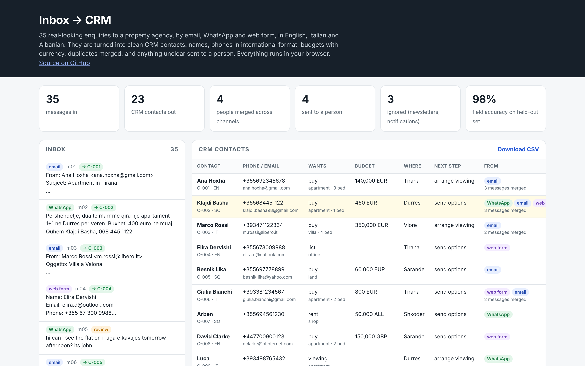
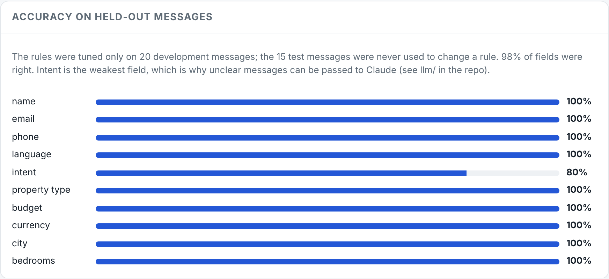
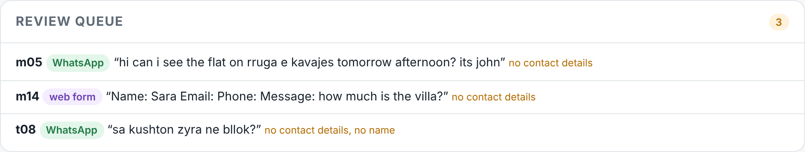
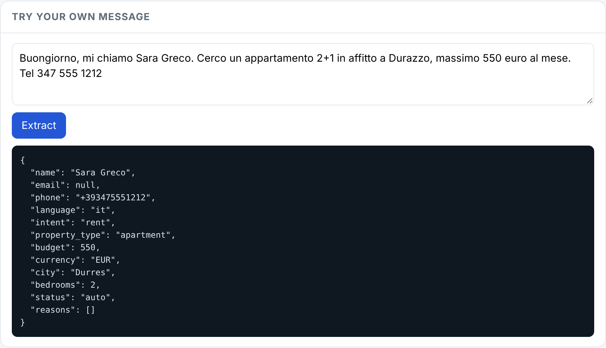

# Inbox → CRM: messy messages into clean contacts

Turns enquiries arriving by **email, WhatsApp and web forms**, in **English, Italian and Albanian**, into clean CRM contacts: real names, phone numbers in international format, budgets with currency, what the person wants and where. The same person writing on three channels becomes **one** contact, and anything unclear goes to a **review queue** instead of polluting the CRM.

Accuracy is **measured**, not claimed: 98% of fields correct on messages the rules never saw.

**▶ Live demo: https://enxo7899.github.io/inbox-to-crm/** (runs entirely in your browser; paste your own message at the bottom)



## What it does

| Step | Detail |
|---|---|
| **Extract** | Name (form fields, email headers, "my name is / mi chiamo / quhem", signatures), email, phone, language, intent (buy / rent / list / viewing), property type, budget and currency ("350 mila euro", "13 milion lekë", "£150,000", "140k"), city (including Italian names like Valona, Durazzo, Scutari), bedrooms (including the Albanian "2+1"). |
| **Normalise** | Phones to E.164 (`069 234 5678` → `+355692345678`, `338…` → `+39…`, `07700…` → `+44…`), emails lower-cased, names title-cased. Phone numbers are stripped before looking for prices, so a number is never read as a budget. |
| **De-duplicate** | Union-find over emails and phones: Klajdi wrote on WhatsApp (phone only), then by email (email only), then through the web form (both), and ends up as one contact with a three-channel timeline. |
| **Keep it current** | The latest stated requirement wins (Ana raised her budget from 120k to 140k), and a viewing request becomes the next step without overwriting what they want. |
| **Review queue** | No contact details, no name, a budget without currency or two cities at once → a person checks it. Newsletters, portal notifications and a lone 👍 are ignored. |
| **Export** | CSV for any CRM (HubSpot, Pipedrive, Airtable, Google Sheets, Supabase). |

## Measured accuracy

`data/messages.json` holds 35 hand-labelled messages. The rules were tuned only on the 20 **dev** messages; the 15 **test** messages were never used to change a rule.

```
$ npm run eval
DEV  (20 messages): field accuracy 100%
TEST (15 messages): field accuracy  98%
  name 100% · email 100% · phone 100% · language 100% · intent 80%
  property_type 100% · budget 100% · currency 100% · city 100% · bedrooms 100%
  auto-filed 13 (fully correct 10) · review 1 · ignored 1
```



The weak spot is **intent** on short follow-ups ("Is the flat in Durrës still free?"): 3 of the 15 test messages got the wrong intent. That's the honest limit of rules, and it's what `llm/extract-llm.js` is for: messages the rules aren't sure about can be sent to Claude with a strict JSON schema, so the model handles the hard tail and the free rules handle the bulk.

## Review queue



## Try your own message



## Run it

```bash
npm install
npm test        # 10 tests incl. a held-out accuracy floor of 95%
npm run eval    # per-field accuracy with every mistake listed
npm run dev     # demo on http://localhost:5174
ANTHROPIC_API_KEY=… node llm/extract-llm.js   # optional: Claude second pass on the review queue
```

| Path | What it is |
|---|---|
| `src/extract.js` | Field extraction and normalisation (no dependencies, runs in browser and Node) |
| `src/crm.js` | De-duplication, merging into contacts, CSV export |
| `scripts/evaluate.mjs` | Field-level accuracy against the labelled set |
| `llm/extract-llm.js` | Optional Claude extraction with structured outputs |
| `data/messages.json` | 35 labelled messages (dev / test split) |

## Adapting it to a real business

The property-agency fields are an example. For a clinic, a restaurant or a B2B supplier, the field list, keyword rules and schema change; the pipeline (extract → normalise → merge → review → export) and the evaluation stay the same. Hooking it to a live inbox is a Gmail / WhatsApp webhook or an n8n workflow that posts each new message to `buildCrm`.

The messages in this repo are written for the demo; no real customer data is included.

---

Built by **[EmSoft](https://github.com/enxo7899)**: data cleaning, CRM set-up and AI automation for small businesses. Get in touch through my Fiverr or Upwork profile.
